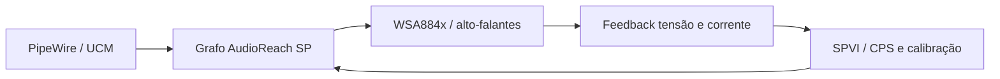

# Proteção dos alto-falantes: investigação e integração

Estado: **integração de proteção ainda não implementada por este trabalho nem validada no Fedora deste aparelho**. O usuário relata speakers e microfone funcionando, com qualidade/volume limitados. A meta inclui proteção real; EQ, AEC, aumento de ganho e taxa de amostragem não a implementam. A configuração de ganho atual permanece preservada.

## Caminho identificado

O candidato [SP11X1e-audio](https://github.com/geocausa/SP11X1e-audio/tree/3232e1dacdeb580a10a9cb8d4756a4518a7bd83e) contém uma implementação específica de AudioReach/WSA884x. O autor relata uma base protegida em hardware X1E. A revisão analisada é `3232e1dacdeb580a10a9cb8d4756a4518a7bd83e` (2026-10-05), com licença raiz BSD-2-Clause; cada patch de kernel exige preservar também sua licença/autoria original. Não foi instalado seu kernel ou aplicado seu instalador.

A fonte [FullIO v19c](https://github.com/geocausa/SP11X1e-audio/blob/3232e1dacdeb580a10a9cb8d4756a4518a7bd83e/deploy/native-audio-v19c/README.md) combina o grafo protegido Golden-v33 e captura de microfone. O caminho envolve módulos SP/SPVI, feedback VI/CPS, calibração e alterações de driver. A [cadeia de reprodução](https://github.com/geocausa/SP11X1e-audio/blob/3232e1dacdeb580a10a9cb8d4756a4518a7bd83e/repro/native-audio-v19c/build-kernel-initrd-and-verify.sh) depende de uma base 7.1.5 específica e patches anteriores; os patches finais de microfone não contêm sozinhos a proteção.



A implementação candidata precisa manter canal/ordem do feedback, configuração por amplificador e ciclo de inicialização/teardown. Iniciar um PCM ou um grafo não comprova que a limitação esteja atuando. A falha de configuração não deve liberar ganho desprotegido.

## Correspondência com o aparelho X1P

Consulta nativa Windows somente de leitura, executada via WSL, identificou CPU `Snapdragon(R) X 10-core X1P64100 @ 3.40 GHz`. Dispositivos presentes:

| Dispositivo | Identificação observada | Driver |
|---|---|---|
| Adaptador de áudio | `AUCD\VEN_QCOM&DEV_0C29&SUBSYS_MSHW0486&REV_0d` | `1.0.4281.8500` |
| DSP/Calibration Manager | `ADSP\VEN_QCOM&DEV_0C22&SUBSYS_MSHW0486&REV_0d` | `1.0.4281.8500` |

A extensão `surface_acsp8380.inf` associa REV_0D aos arquivos de calibração nas linhas 114–115 e 131–132. O arquivo local `acdb_cal_0D.acdb` tem SHA256 `a0a8635ba65127180a1caef46af61c00171c9a93cbf8b5f5650709b4638decde`: é **idêntico** ao hash registrado no [artefato do candidato](https://github.com/geocausa/SP11X1e-audio/blob/3232e1dacdeb580a10a9cb8d4756a4518a7bd83e/artifacts/reviewed/windows-acdb-runtime-ckv-20260728.json). Isso favorece investigar a mesma família de calibração. Não comprova identidade de cada transdutor, calibração individual R0/T0, comportamento térmico ou compatibilidade com nosso firmware/kernel.

Na extensão `surface_audiominiext8380.inf`, linha 159, o valor padrão REV_0D aparece como `0xFFF40000`, comentado `-12.0dBFS`. Esse é um valor de política Windows, **não** um limite seguro automaticamente transferível para controles ALSA.

## Artefatos locais de origem

Os caminhos são relativos ao DriverStore do próprio aparelho. Os binários e ACDB permanecem locais/ignorados.

| Fonte | Bytes | SHA256 |
|---|---|---|
| `surface_acsp8380.inf_arm64_f6524e4db745e12a/REV_0D/acdb_cal_0D.acdb` | 440150 | `a0a8635ba65127180a1caef46af61c00171c9a93cbf8b5f5650709b4638decde` |
| `qcaucd8380.inf_arm64_53bcc309a68aba55/qcaucd8380.sys` | 354016 | `bd0c8276c51fc7a020c616e904dd613b6ccf187ec3e1fe6f94c2c811c8adc8bf` |
| `qcadcm8380.inf_arm64_f5fba49e0720d715/qcadcm8380.sys` | 768224 | `37f76305ac8051b0b03b6d2ce1df7a353253debf546e512e447c9d95ec661429` |
| `qcaudminiport_base8380.inf_arm64_738ad101f903ae9b/qcaudminiport8380.sys` | 703200 | `79b26804d05332304c736c4e03e942db6a07ea886a2b07f3a4ff5947d1d05531` |
| `surface_audiominiext8380.inf_arm64_5f9fc16bb2caf005/surface_audiominiext8380.inf` | 183224 | `5acd5091f45da4232945046eeedc913bff75c57adc6e17954391264d7cec8134` |
| `surface_acsp8380.inf_arm64_f6524e4db745e12a/surface_acsp8380.inf` | 10292 | `df97a908af9fc21da4112ec202c615436d26a63354bda951b0210a01fa26f3b6` |

## Observações REA

REA 6.5.0 / GNU AArch64 objdump capturou cabeçalhos de `qcadcm8380.sys`; evidência `ev_a3093b80134b0a51f501de449c00e27ed39621f315bdb92d6352db80ac47f28f`. Exit 0, hash antes/depois inalterado. Envelope privado: `output/speaker-protection/rea/qcadcm-file-headers.json`. Uma busca independente de bytes ASCII encontrou:

| Offset de arquivo | String |
|---|---|
| `0xa21a8` | `CreateSpkrProtRxPayload` |
| `0xa2238` | `CreateSpkrProtViExModePayload` |
| `0xa22d0` | `CreateSpkrProtVIPayload` |
| `0xa2360` | `CreateSpkrProtR0T0ViPayload` |

Essas strings são pistas de construção de parâmetros, não funções decompiladas nem prova de execução. O próximo passo de REA é seguir referências e call sites dessas rotinas, correlacionando IDs/tamanhos/ordem com a topologia e o código candidato. Nenhum comando de DSP ou de amplificador foi enviado ao hardware.

## Compilação da topologia no Fedora 44

A fonte candidata `X1E80100-Microsoft-Surface-Pro-11-FullIO-v19c0.conf` tem hash `241f32cd2278c7df745f17a6c70f3259109b68ffeea1d4984353de4afd99bc39`. Em container Fedora44, usando `alsa-topology-utils-1.2.16-1.fc44.aarch64`, `alsa-topology-1.2.16.1-1.fc44.noarch` e `alsa-lib-1.2.16.1-1.fc44.aarch64`, a compilação gerou 35128 bytes e SHA256:

```text
e7bb06a03e7bd9b869825a51775355a6743477d1579d78eb09fad5881cfb20f0
```

O hash é exatamente o publicado no manifesto v19c. O compilador também emitiu avisos sobre endpoints externos `WSA_CODEC_DMA_RX_0 Playback`, `WSA_CODEC_DMA_TX_0/1 Protection` e `TX_CODEC_DMA_TX_3 Capture`; esses endpoints dependem do driver correspondente. Portanto a reprodução binária não prova fechamento do grafo em nosso kernel. Resultado privado: `output/upstream-research/fullio-v19c-rebuilt.tplg.bin`. Não foi copiado para o firmware em uso.

## Diferença para o kernel/topologia atualmente empacotados

A topologia de 23KB existente no repositório foi decodificada sem encontrar os nomes de módulos/tags de proteção do candidato. O módulo `snd-q6apm` empacotado não contém os nomes `audioreach_configure_protection` e `audioreach_send_protected_graph_calibration` usados pelo patch candidato. Esses são indícios de diferença de implementação, não uma auditoria completa do firmware ou do kernel em execução. A revisão física ainda não foi coletada.

Não basta substituir o `.tplg.bin`: a cadeia contém mudanças no q6apm/AudioReach, WSA884x, SoundWire, macros LPASS, configuração de portas, DT e UCM. O candidato usa outra base/ABI; módulos não podem ser intercambiados com `7.2.8-arch1-3-sp11` apenas renomeando arquivos.

## Sequência de implementação e validação

1. Recuperar a cadeia completa de fontes/patches da base protegida, fixar revisões e fazer port para uma árvore de kernel isolada com o DTB LCD. Compilar kernel, módulos e topologia como conjunto.
2. Preservar a inicialização atual e criar entrada candidata independente, com hashes e rollback. Usar calibração do próprio aparelho e confirmar firmware, revisão do amplificador e mapeamento de canais.
3. No Fedora físico, verificar configuração SP/SPVI, status do DSP, feedback VI correto nos dois canais e comportamento em abertura/fechamento, falha de configuração e retomada. A análise deve distinguir corrente/tensão e canais esquerdo/direito.
4. Demonstrar atuação dos mecanismos de proteção e limites do modelo/calibração com instrumentação e critérios definidos; não usar apenas volume percebido, `aplay` bem-sucedido ou ausência de mensagens como prova.
5. Só promover a saída protegida após essas verificações; então avaliar fidelidade/perfis e a necessidade de processamento adicional. Preservar o microfone que já funciona.

## Critérios de aceitação da proteção

Antes de aumentar qualquer limite, falta estabelecer o envelope elétrico, térmico e mecânico admissível para os transdutores desta revisão. Isso exige dados do fabricante ou caracterização de engenharia com instrumentação adequada; não há neste projeto limites numéricos comprovados de temperatura, excursão ou potência. Sem esses limites, o resultado permanece **experimental, sem autorização técnica para elevar ganho**.

A validação deverá produzir um pacote privado com revisão/hash do kernel, DTB, firmware, topologia e UCM; revisão dos amplificadores; origem e validade de R0/T0 por unidade; configuração e respostas dos módulos SP/SPVI/CPS; identificação explícita de canais e unidades de medida. Registrar também procedimento, instrumentos/calibração, estímulo limitado, condições térmicas, duração, limites de interrupção e medições sincronizadas. Não copiar calibração individual de outra unidade.

| Verificação | Evidência requerida / condição de aprovação |
|---|---|
| Grafo e parâmetros | Respostas de configuração aceitas pelo DSP e leitura/instrumentação que confirme o caminho SP/SPVI ativo; ausência de erro sozinha não aprova. |
| Feedback dos dois alto-falantes | Dados VI não nulos/plausíveis, separados por canal e grandeza, com mapeamento e escalas confirmados; rejeitar feedback ausente, trocado ou congelado. |
| Atuação | Demonstrar limitação prevista pelo modelo dentro do envelope estabelecido, correlacionando telemetria, sinal de saída e medição independente; não executar ensaio destrutivo para descobrir o limite. |
| Falhas | Inspeção de código e teste controlado das falhas de configuração/feedback/calibração devem demonstrar recusa do caminho protegido ou manutenção do limite conservador; nunca liberar ganho por falha. |
| Ciclo de vida | Repetir abrir/fechar, suspensão/retomada e reinicialização; confirmar reconfiguração válida antes de saída e ausência de estado residual perigoso. |
| Regressões | Confirmar canais, microfone e estabilidade, com logs de falhas e XRUN; comparação de fidelidade separada da prova de proteção. |

A implementação de telemetria e a definição desses limiares são tarefas pendentes. Nenhum comando de coleta atual mede excursão/temperatura real ou certifica segurança do alto-falante.

## Reprodução e retenção

A coleta Windows usou `Get-CimInstance Win32_Processor | Select-Object Name` e `Get-PnpDevice -PresentOnly` nos prefixos AUCD/ADSP, lendo somente HardwareIds, DriverInfPath e DriverVersion. O comando completo e resultado estão em `output/speaker-protection/windows-audio-present.json`. Manifesto de fontes: `output/speaker-protection/windows-source-manifest.json`. Strings: `output/speaker-protection/protection-strings.json`.

Para repetir a inspeção REA:

```sh
REA_OBJDUMP_COMMAND=/usr/bin/aarch64-linux-gnu-objdump \
  npx --yes rea-agents@6.5.0 inspect-with-objdump \
  /mnt/c/Windows/System32/DriverStore/FileRepository/qcadcm8380.inf_arm64_f5fba49e0720d715/qcadcm8380.sys \
  file_headers --format json
```

Para recompilar a fonte já obtida e conferida pelo hash acima, dentro de ambiente Fedora44 isolado:

```sh
dnf install alsa-topology-utils
alsatplg -c X1E80100-Microsoft-Surface-Pro-11-FullIO-v19c0.conf -o candidate.tplg.bin
sha256sum candidate.tplg.bin
```

Isso compila dados e não carrega topologia nem ativa áudio. Consulte também [diagnóstico de áudio](../AUDIO_DIAGNOSTICS.md) e [estado de todas as fases](../MIGRATION_STATUS.md). Fontes e observações consultadas em 2026-10-15.
